# Ibtekr Ops

**A production operations system for a handmade marketplace, designed and built by a team of three using AI agents (Claude Code).**

### ▶ [Live demo — demo.ibtekr.club](https://demo.ibtekr.club) · 🎬 [Video walkthrough (1:20)](https://demo.ibtekr.club/demo-walkthrough.mp4) · 📦 [Repository](https://github.com/Ibtekr-club/Ibtekr-ops-showcase)

The demo runs entirely in your browser on sample data — pick *Marketplace* or *Single store*, change anything, press *Reset*.
It is in **Arabic or English**: the «عربي / English» switch sits at the bottom of the side menu (in the top bar on a phone).

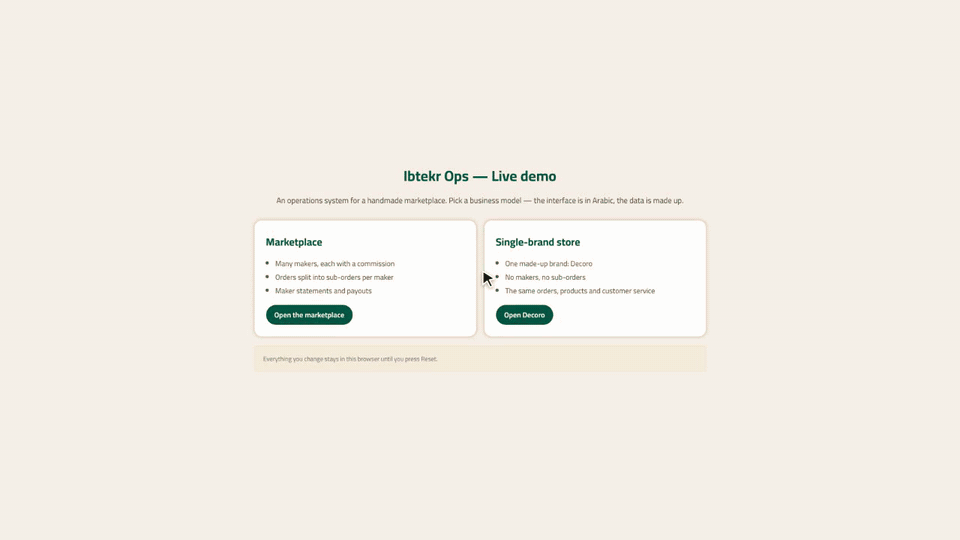

| Pick a business model | Dashboard | Orders |
|---|---|---|
| 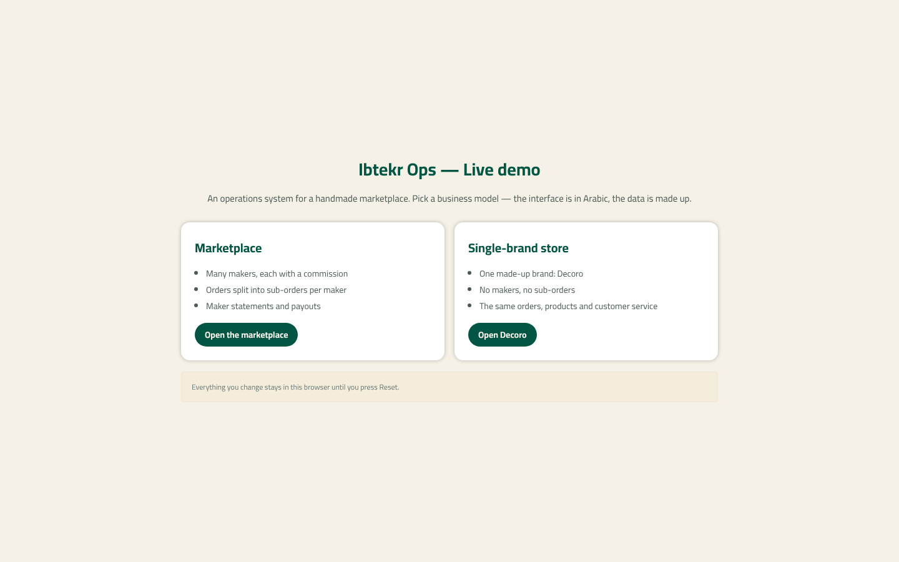 | 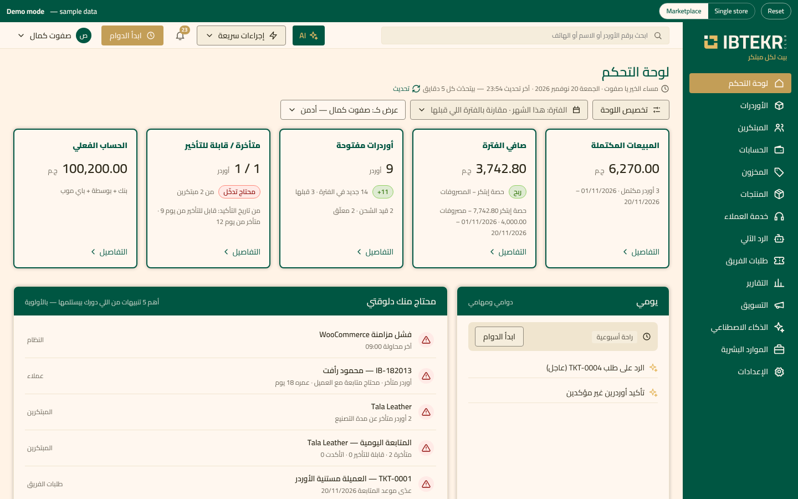 | 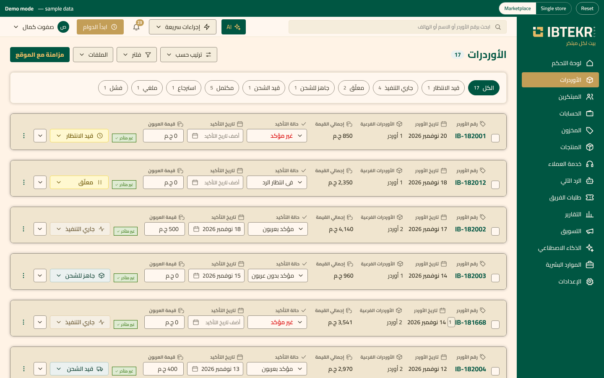 |

| Dashboard in English | Orders in English |
|---|---|
| 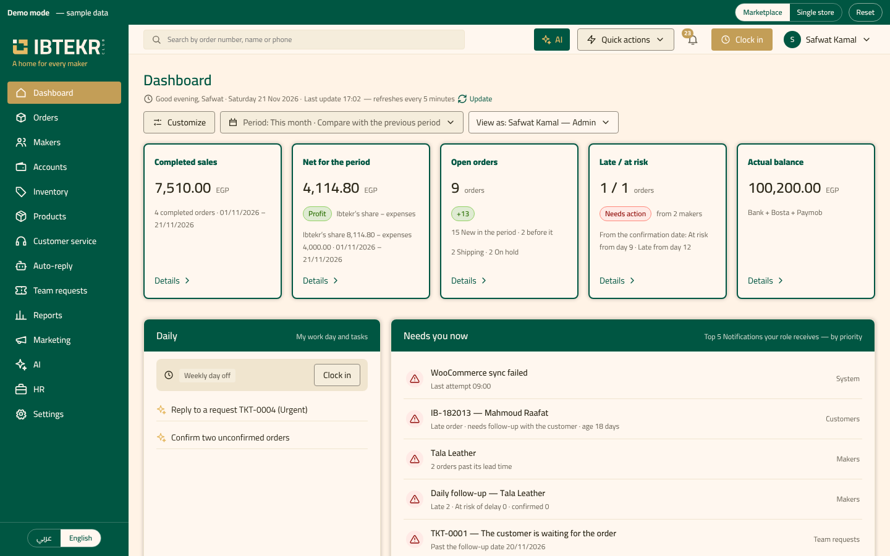 | 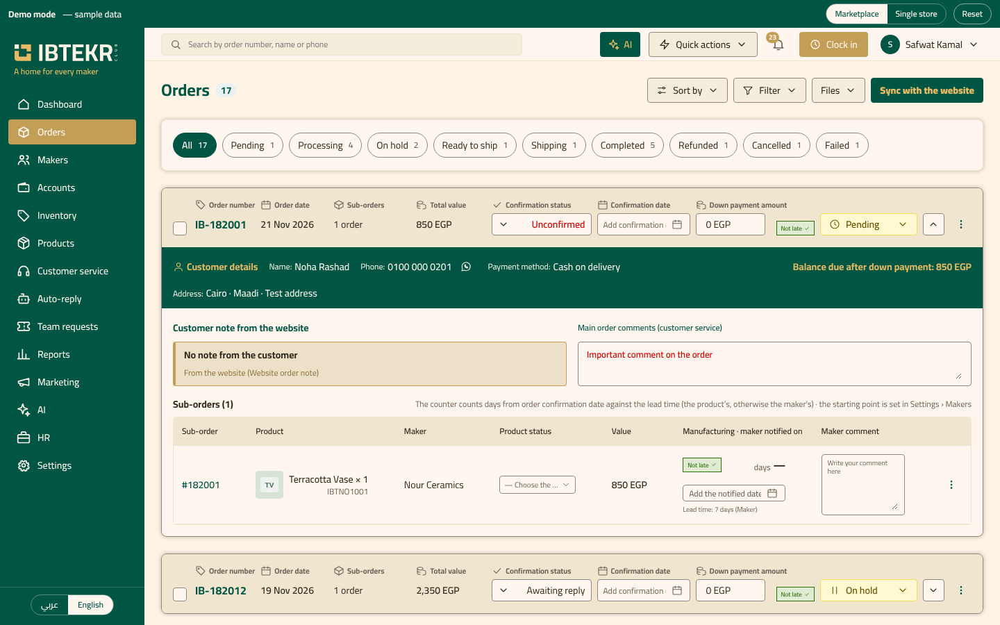 |

---

## The problem

Ibtekr Club runs a multi-vendor marketplace for handmade products: 50+ brands, about 300 orders a month, and a team of four.
Before this system, the work lived in spreadsheets and manual follow-up — orders copied out of WooCommerce, makers chased on
WhatsApp one by one, commissions and payouts reconciled by hand, customer messages spread across several inboxes.

The goal: one place where the team runs the day — orders, makers, money, products, customers — with the shop kept in sync and
nothing important left in someone's head.

## Key features

### 1. Orders and site sync
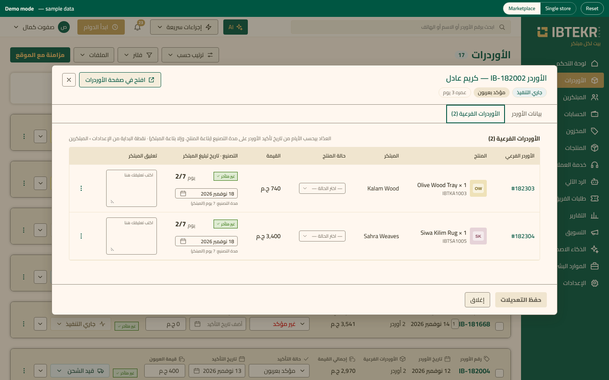

Orders arrive from WooCommerce through signed webhooks and are worked on here: confirmation, deposit, status, delays, courier.
An order shared between several makers is shown with its Dokan sub-orders, each with its own product status and maker deadline.
A status change made by a person goes back to the site — the system never writes to the shop on its own.

### 2. Products and the AI studio
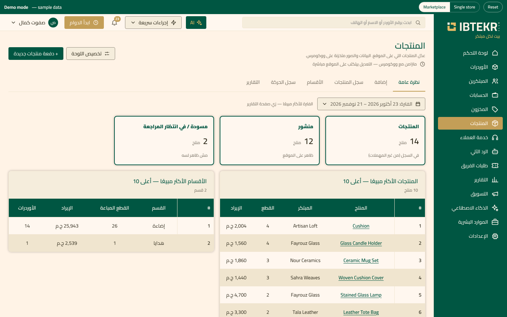

The product catalogue is mirrored from the shop and edited here. The studio turns a maker's sheet, WhatsApp screenshots or
photos into ready product listings: Arabic and English names and descriptions written by Claude, SKUs built by rule, and
product shots generated with an image model — reviewed by a person before anything is published.

### 3. Customer service and WhatsApp
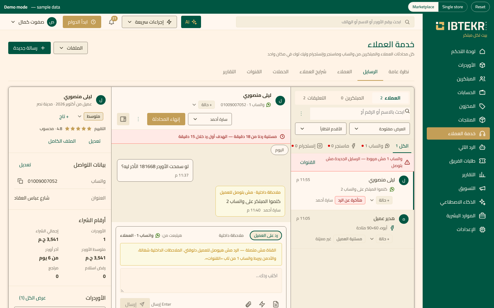

WhatsApp, Messenger, Instagram and post comments in one inbox, next to the customer's orders, ratings and notes. Auto-reply
rules answer order events and first messages; the AI assistant prepares a reply when the team is late — a person sends it.

### 4. Makers and commissions
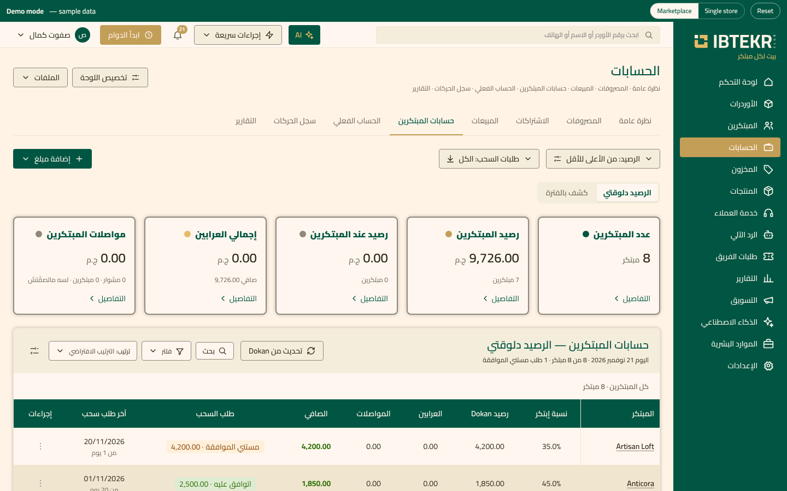

Every maker has a commission (fixed or by category), a statement and a balance synced from Dokan. Deposits and transport
costs are deducted, withdrawals are approved from here, and the numbers add up: balance = earnings − approved withdrawals.

### Also in the system
- **Dashboard** with each member's priorities and the day's numbers
- **Accounts**: expenses, subscriptions, sales, real accounts and a movement log
- **Inventory**: a hub for gathering multi-maker orders, returns and photo shoots, with stock counts
- **Team requests** between roles, with a chat per request
- **Reports** across orders, makers, accounts, products, inventory and customer service, with period comparison
- **Marketing**: campaigns built with AI, scheduled publishing to Facebook/Instagram, and ad numbers next to real orders
- **AI assistants** per team (media buyer, designer, developer, operations, customer service, accountant, HR) that explain, prepare and ask — a person decides
- **HR**: flexible attendance, payroll, evaluations and leave
- **Settings**: roles with three permission levels, editable lists and statuses, integrations, branding
- **A makers' portal** for their own orders and balance

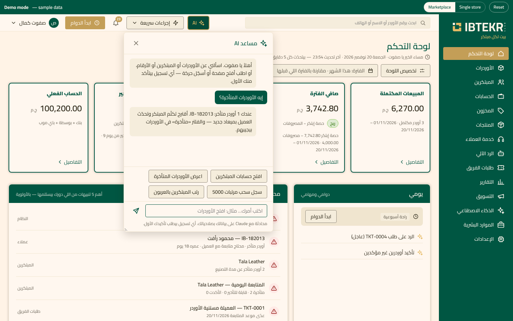

## One system, two business models

| | Marketplace | Single store |
|---|---|---|
| Makers, commissions, statements | ✅ | — (hidden) |
| Dokan sub-orders per maker | ✅ | — |
| Orders, statuses, delays, courier | ✅ | ✅ |
| Products and the AI studio | ✅ (per maker) | ✅ (one brand, price = cost + margin) |
| Customer service, accounts, inventory, reports, HR, marketing | ✅ | ✅ |

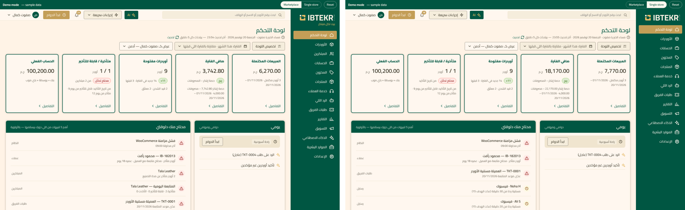

**Both models are one configuration setting, not two codebases.** The *store* setting says which platform and which model;
every page asks it what to show.

## Architecture

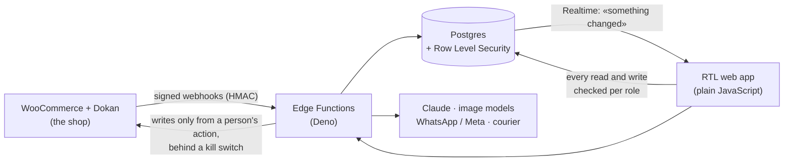

- **Frontend**: plain JavaScript, no framework and no build step; every write goes through a small adapter layer.
- **Backend** (not in this repository): Supabase — Postgres with Row Level Security on every table, permissions checked by role
  and level in the database, and Edge Functions for sync, AI and messaging. Described in words in
  [docs/architecture.md](docs/architecture.md).
- **The demo**: the same app on an in-browser stand-in for the backend (`tests/e2e/supabase-mock.mjs` and `mock/shared/`) — the
  same tables, permission rules and function results, with made-up data, kept in `localStorage` until *Reset*. It is also what
  the end-to-end tests run against.
- **The English version**: a layer of the demo only (`tools/demo/i18n.js` and the dictionary in `tools/demo/i18n/`, about
  14,200 entries). It translates what the app writes to the page and the sample data, and mirrors the layout to
  left-to-right — the app's own code is not changed, and the production system stays Arabic.

## Design process

- **Understanding the team's needs.** The requirements came from the team's own day-to-day work: each member described what
  they needed to make their job easier, and those needs became the pages and the rules of the system.
- **Prototype first, then real data.** Every page started as a clickable prototype the team commented on; only then was it built
  on real data, keeping what the prototype got right. A live copy on sample data let the owner leave comments on the real screens
  instead of sending screenshots — which made the whole review loop much easier.

Three design decisions and why:

1. **The interface speaks Egyptian Arabic, on purpose.** The users are the team in Egypt; buttons and messages are written the way
   they talk ("ابدأ الدوام", "مستنية ردنا"), right-to-left throughout. The team found it easy and natural to work with.
   (The English in the demo was added for visitors who do not read Arabic; the team works in Arabic.)
2. **The system prepares, a person decides.** AI assistants draft replies, fill forms and suggest budget changes, but nothing is
   sent, published or paid without a click — and every write to the shop comes from a person, behind a global switch.
3. **Built on staging, switched to live in one step.** Everything was built and tested against a staging shop first, so the
   real store was never the test bench; moving to the live store was a single switch, and it is now running live.

## Team

- **Safwat Kamal** — CEO, Ibtekr Club · UI/UX Designer (product direction, UX)
- **Mohamed Gamal** — Developer (engineering)
- **Fares Karam** — UI/UX Designer

**How Claude Code was used.** The system was built as an agentic workflow: each phase had a written plan and recorded decisions
(what the owner asked for, in his words), Claude Code implemented it task by task, and every business rule came with a test. CI
ran the unit tests, the end-to-end tests on the in-browser backend, the database's RLS tests and a security scan on every change.
The team directed, reviewed and decided; the agent wrote and tested the code.

## By the numbers

Counted from the production repository (22 Oct – 20 Nov 2026):

| | |
|---|---|
| Commits | 1,201 — 1,196 of them written by the agent (Claude Code) |
| Database migrations | 148 |
| Edge Functions | 15 |
| RLS test files (SQL) | 121 |
| Unit tests (Node) | 1,014 |
| Edge Function tests (Deno) | 410 |
| End-to-end tests (Playwright) | 749 in 73 files |
| Frontend code (JS / CSS / HTML, without libraries) | ~40,000 lines |
| SQL | ~18,000 lines in the migrations, ~17,000 in the RLS tests |

## Tech stack

Plain JavaScript (no framework, no build) · Supabase (Postgres, Row Level Security, Edge Functions on Deno, Realtime) ·
WooCommerce + Dokan · Claude API · WhatsApp Cloud API / Meta Graph API · Playwright · `node:test` · Semgrep.

## Run the demo locally

Requires Node 22.

```bash
git clone https://github.com/Ibtekr-club/Ibtekr-ops-showcase.git
cd Ibtekr-ops-showcase
npm ci
npm run demo:web                                  # builds dist/demo-web
npx http-server dist/demo-web -p 4191             # open http://localhost:4191
```

Tests: `npm test` (unit), `npm run e2e` (end-to-end on the in-browser backend), `npm run e2e:demo` (the web demo — both models, Arabic and English).

## License

Copyright (c) 2026 Ibtekr Club. All rights reserved. The code is published for viewing only — see [LICENSE](LICENSE).
